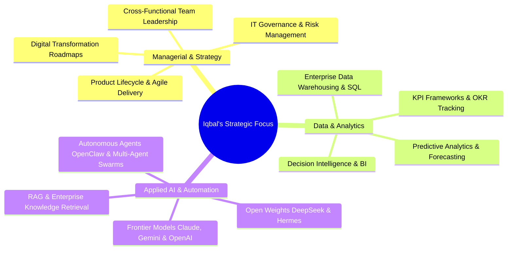

# Muhamad Iqbal Nurmanditya

**Technology Leader • IT & Analytics Strategist • Applied AI Innovator • Founder of Unicode Creative**

*Bridging executive business strategy, data analytics, and modern AI systems to build scalable digital transformation and measurable organizational impact.*

---

## 🎯 Executive Overview & Leadership Philosophy

With a multidisciplinary foundation across **enterprise IT, business analysis, and digital innovation**, I specialize in translating complex organizational objectives into high-performing technology solutions. As the founder of **Unicode Creative** and a digital transformation partner for government and enterprise initiatives (including **Kemenparekraf**), I focus on driving operational excellence through data intelligence and human-centered technology.

My philosophy centers on **empowering leadership through data and autonomous intelligence**: ensuring organizations leverage technology and AI to amplify human capability, drive revenue, and make proactive, data-informed decisions rather than reacting to disruption.

---

## 💼 Core Competencies & Strategic Pillars

### 1. 🏛️ Technology & Product Management
- **Digital Transformation & Delivery:** Designing strategic roadmaps, modernizing legacy processes, and executing high-stakes public- and private-sector digital initiatives.
- **Agile Leadership & Governance:** Mentoring cross-functional product, design, and engineering squads using Scrum/Kanban frameworks to deliver predictable, high-velocity outcomes.
- **Stakeholder & Vendor Alignment:** Bridging C-level business vision with technical execution, translating commercial requirements into robust architectural roadmaps.

### 2. 📊 Analytics & Decision Intelligence
- **Data-Driven Strategy:** Architecting executive KPI dashboards, operational metric models, and analytics funnels that guide strategic investments.
- **Business Intelligence (BI) & Modeling:** Advanced querying, data pipeline modeling, and cohort analysis across relational, transactional, and analytical data stores.
- **Impact Measurement:** Establishing quantitative frameworks to measure digital adoption, user retention, conversion efficiency, and operational ROI.

### 3. 🤖 Applied AI & Cognitive Systems
- **Multi-Model Orchestration:** Leveraging frontier proprietary models (**Anthropic Claude**, **Google Gemini**, **OpenAI**) alongside state-of-the-art open-weights reasoning architectures (**DeepSeek-V3 / R1**, **Nous Hermes**) to optimize cost, latency, and cognitive capabilities.
- **Agentic Architectures & Autonomous Workflows:** Designing robust agent pipelines with **OpenClaw**, autonomous task loops, and function calling to execute multi-step research, operational automation, and code synthesis.
- **RAG & Knowledge Retrieval:** Implementing vector embeddings, contextual retrieval, and hybrid search pipelines to ground models in verified enterprise data.
- **AI Governance & Strategic Integration:** Aligning token economics, privacy compliance, prompt evaluation, and ethical risk management with overarching business goals.

---

## 🔭 Current Strategic Initiatives

- 🏛️ **Digital Governance & Transformation:** Supporting national-scale digitalization frameworks with [Kemenparekraf](https://kemenparekraf.go.id/) in partnership with [Unicode Creative](https://uncodecreative.com).
- 🧠 **Enterprise Applied AI & Agent Systems:** Building multi-agent workflows using **OpenClaw**, **Claude**, and **DeepSeek / Hermes** for intelligent automation and data synthesis.
- 📈 **Continuous Executive Growth:** Deepening expertise in Human Capital Architecture, Data-Driven Capital Allocation, and Scaled AI Product Management.

---

## 🛠️ Management, Analytics & Technology Stack

### 👔 Management, Strategy & Delivery

### 📊 Analytics & Business Intelligence
-3776AB?style=flat-square&logo=python&logoColor=white)
-4479A1?style=flat-square&logo=mysql&logoColor=white)

### 🤖 Applied Artificial Intelligence & Automation

-1E40AF?style=flat-square&logo=deepseek&logoColor=white)
-6B21A8?style=flat-square)
-0D9488?style=flat-square)

-EA4B88?style=flat-square)

### ☁️ Infrastructure & Software Architecture

-68A063?style=flat-square&logo=nodedotjs&logoColor=white)

---

## 🏆 Honors & Global Recognition

- 🌍 **7th Place Worldwide** • [Microsoft Office Specialist World Championship (2021)](https://certiport.pearsonvue.com/Blog/2021/November/2021-Microsoft-Office-Specialist-World-Champions.aspx)  
- 🥈 **2nd Place Winner** • [International Innovation Academic Competition and Exhibitions (2020)](https://pasjabar.com/2020/12/12/usbb-juara-2-lomba-international-inovasi-akademik/)  

*Recognized by national institutions and academic bodies including MyEduSolve, ITS, Tekno Sains Academy, and Universitas Sangga Buana for excellence in digital innovation, business problem-solving, and analytical proficiency.*

### 📰 Featured Media Coverage:
- [PramborsFM • Indonesian Representatives in International Championship](https://www.pramborsfm.com/news/4-pelajar-indonesia-siap-jadi-perwakilan-kompetisi-microsoft-dan-adobe-internasional)
- [Tempo • Microsoft Adobe National Championship](https://event.tempo.co/read/1560756/microsoft-adobe-national-championship-hadir-kembali)
- [Times Indonesia • Digital Capability Development](https://timesindonesia.co.id/pendidikan/393822/myedusolve-gandeng-its-gelar-microsoft--adobe-national-championship-2022)
- [Islampos • International Innovation Academic Award](https://www.islampos.com/mahasiswa-teknik-universitas-sangga-buana-raih-juara-lomba-international-innovation-academic-competition-and-exhibitions-218660/)

---

## 🤝 Let's Collaborate

I am open to discussions on **advisory roles, enterprise digital transformation, AI/analytics roadmapping, and strategic technology consulting**.

